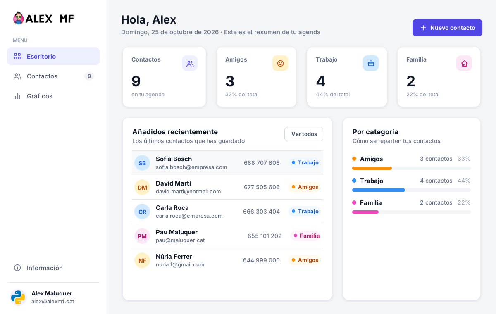
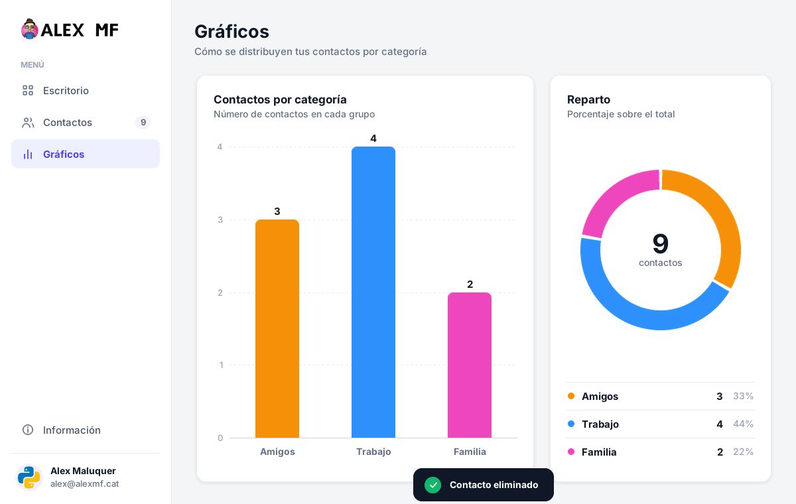

# 📇 Agenda de Contactes

Aplicació d'escriptori feta amb **Python + Tkinter** per gestionar els teus contactes: afegir-los, editar-los, eliminar-los, cercar-los i veure'n estadístiques per categoria, amb una interfície moderna i neta.



## ⬇️ Descàrrega (Windows)

No cal tenir Python instal·lat:

1. Ves a **[Releases](https://github.com/alexmfv3/agendaContactes_py/releases/latest)** i descarrega **`AgendaContactes-windows.zip`**.
2. Descomprimeix-lo i fes doble clic a **`Agenda.exe`**.

> La primera vegada, Windows SmartScreen pot mostrar un avís perquè l'executable no està signat. Prem **«Més informació» → «Executa igualment»**.

Els contactes es guarden a `libreta\agenda.json`, al costat de l'executable. Si aquella carpeta no permet escriure (per exemple, dins d'*Arxius de programa*), es guarden a `%APPDATA%\AgendaContactos`.

## ✨ Funcionalitats

| Secció | Què fa |
|---|---|
| **Escritorio** | Resum de l'agenda: total de contactes, recompte per categoria, darrers contactes afegits i repartiment en percentatge. |
| **Contactos** | Directori ordenat alfabèticament amb cercador i filtres per categoria. Fitxa lateral per **afegir**, **editar** i **eliminar** (amb confirmació). |
| **Gráficos** | Gràfic de barres i gràfic d'anell per categoria (Amics, Feina, Família). |
| **Información** | Dades de l'aplicació i de l'autor. |

A més:
- Validació dels camps (nom, telèfon i email) amb els errors marcats al mateix camp.
- Notificacions breus en afegir, desar o eliminar.
- Si `agenda.json` es fa malbé, se'n guarda una còpia (`agenda.json.bak`) abans de començar de nou.

<p>
  
  
</p>

## ⌨️ Dreceres de teclat

| Drecera | Acció |
|---|---|
| `Ctrl+1` / `Ctrl+2` / `Ctrl+3` | Escritorio / Contactos / Gráficos |
| `Ctrl+N` | Contacte nou |
| `Ctrl+F` | Cercar |
| `Enter` | Desar la fitxa |
| `Esc` | Cancel·lar l'edició o netejar la cerca |

## 🐍 Executar des del codi

Requereix **Python 3.9 o superior** (amb Tkinter, que ja ve inclòs a l'instal·lador oficial de Windows).

```bash
git clone https://github.com/alexmfv3/agendaContactes_py.git
cd agendaContactes_py
python -m pip install -r requirements.txt
python main.py
```

`plotly` és opcional: si està instal·lat, a la secció de gràfics apareix el botó «Abrir en el navegador» amb el gràfic interactiu.

## 🛠️ Compilar l'executable

**Automàticament (GitHub Actions):** en publicar una nova Release a GitHub (*Releases → Draft a new release*), el workflow [`build-release.yml`](.github/workflows/build-release.yml) compila `Agenda.exe` en una màquina Windows i l'adjunta a la Release.

**Manualment a Windows:** fes doble clic a [`compilar.bat`](compilar.bat). Deixa el resultat a `dist\Agenda.exe`.

## 📁 Estructura

```
main.py                    Punt d'entrada
conf.py                    Colors, categories i rutes
formularios/               Pantalles (finestra principal, escriptori, contactes, gràfics, info, alertes)
util/util_ui.py            Components visuals (targetes, botons, camps, píndoles, avatars…)
util/util_imagenes.py      Formes, icones i gràfics dibuixats amb Pillow
util/util_agenda.py        Lectura, escriptura i validació de l'agenda
libreta/agenda.json        Dades dels contactes
compilar.bat               Compilació manual de l'executable
```

## 👤 Autor

**Alex Maluquer** · [alex@alexmf.cat](mailto:alex@alexmf.cat)
